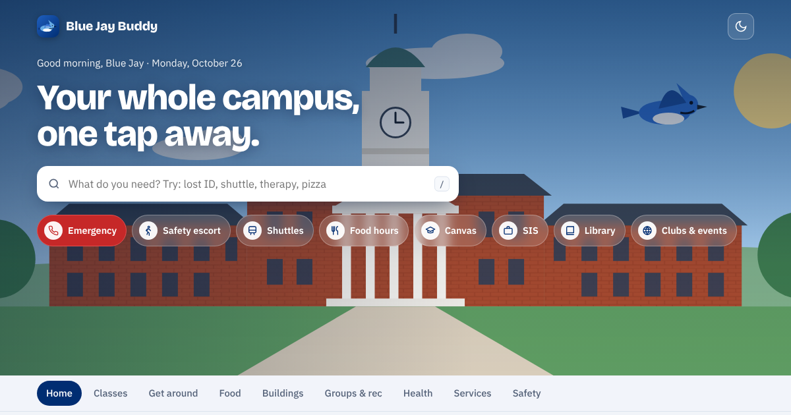

# Blue Jay Buddy

A no-login student hub for Johns Hopkins University's Homewood campus. Everything a student reaches for during the week sits on one page: shuttles, food, buildings, services, health, safety numbers, clubs and your own class schedule.

**Live site:** https://sahiljangra12.github.io/blue-jay-buddy/



## What it does

- **Make it mine**: a 1-minute setup (about you, program, where you live, classes, interests) that builds a personal home screen with a first-weeks checklist and picks for you.
- **Step-by-step guides** for 24 everyday tasks (JHED and MFA, Wi-Fi, J-Card on your phone, health insurance, key academic dates, TransLoc, night rides, printing, lost and found, health appointments, OIS check-in and more), with App Store and Google Play buttons where an app exists.
- **In person, online or hybrid classes**, each with an Edit button. Online classes get a "Join class" button for the meeting link.
- **Animated campus illustrations** instead of photos: original artwork drawn in code for the quads, Gilman Hall, Brody, the library, Shriver, Homewood Museum and the gate, plus a unique animated drawing for every building. The sky follows the time of day, animations pause off screen, and they stop for anyone who prefers reduced motion.
- **Report a problem** on every card and guide, and a **Checked** month on every card, so students can see how recent the information is.
- **Calls always ask first**: every call button opens a confirmation, so nobody dials the emergency line by accident.

- **Search everything** in plain words ("lost ID", "visa", "therapy", "pizza"). Press `/` to jump to search.
- **Quick actions** for the campus emergency line, safety escort, shuttles, food hours, Canvas, SIS, the library and clubs.
- **Up next**: add your classes once and the home screen shows your next class, a countdown and walking directions.
- **Calendar export**: download your timetable as an `.ics` file for Google Calendar, Apple Calendar or Outlook.
- **Favorites**: star any card to pin it to the home screen.
- **Buildings**: about 30 Homewood buildings with one-tap Google Maps directions.
- **Installable and offline**: add it to your phone's home screen. It opens even without a connection.
- **Light and dark mode**, and an illustrated campus header whose sky follows the time of day.

## Privacy

There is no login, no server and no tracking. Classes, favorites and theme are stored only in your browser's local storage.

## Editing content

All links, phone numbers and buildings live in [`data.js`](data.js). Edit an entry there and push; the site updates by itself. After each pre-semester link check, update `reviewed` at the top of `data.js` (or give a single entry its own `c: "YYYY-MM"`). Problem reports and feedback go to the address in `contact`. When you change any file, bump `VERSION` in [`sw.js`](sw.js) so installed copies refresh.

## Run locally

```bash
python3 -m http.server 8000
# open http://localhost:8000
```

## Disclaimer

This is an independent student project and is not an official Johns Hopkins University website. Hours and schedules change; every card links to the official source. All illustrations are original artwork drawn in code for this project.

## License

MIT
